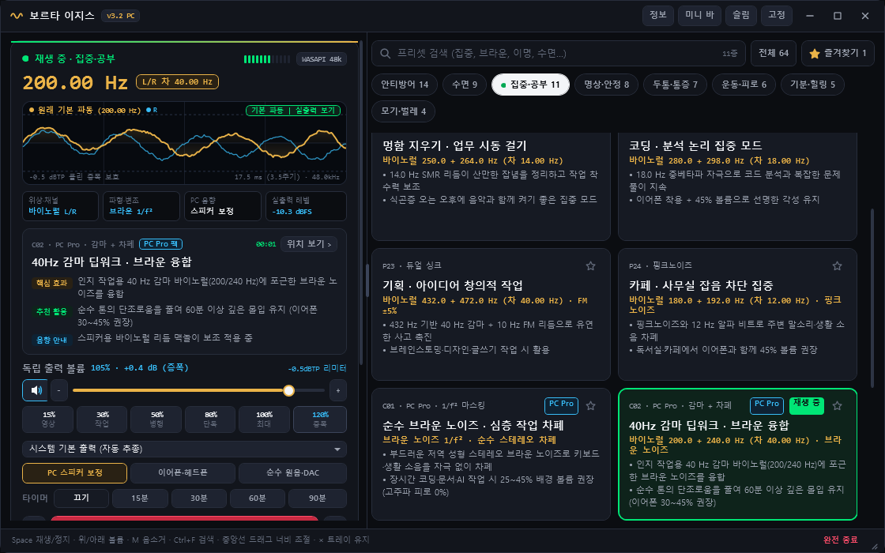
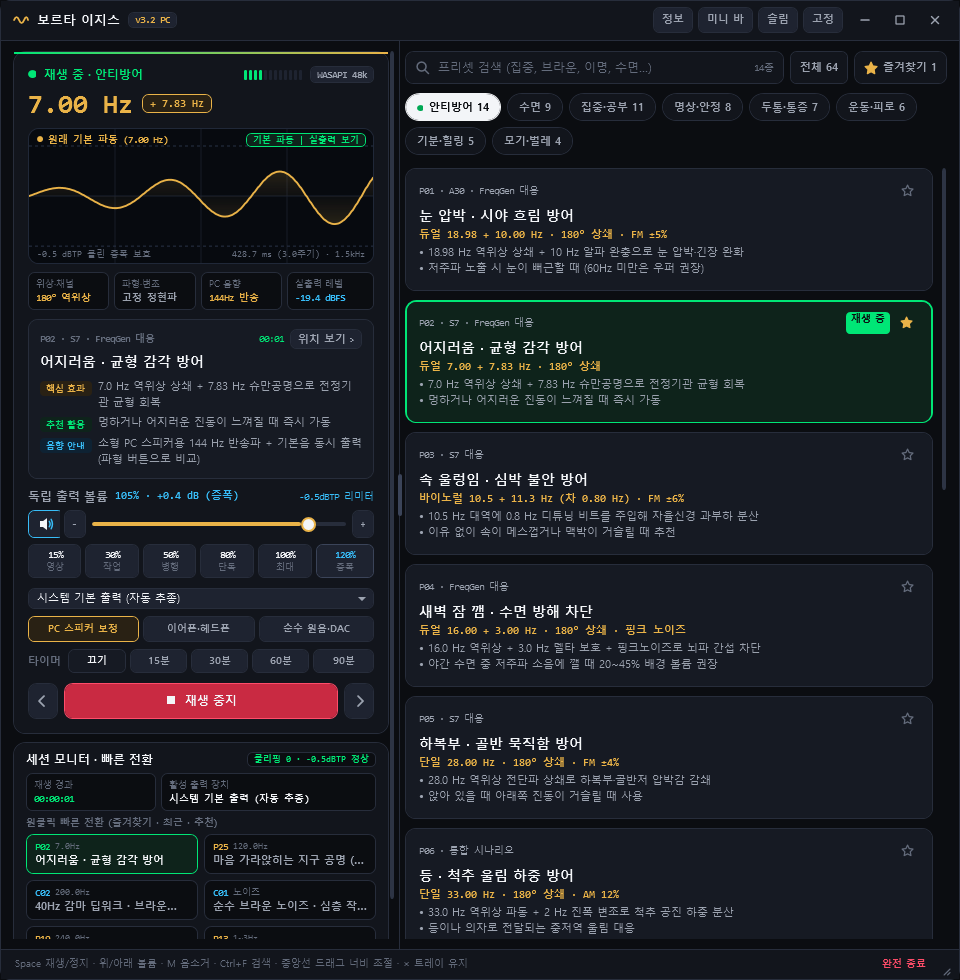
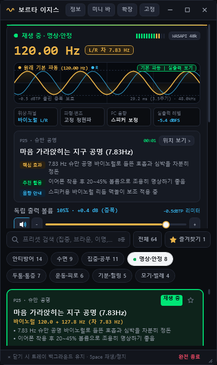
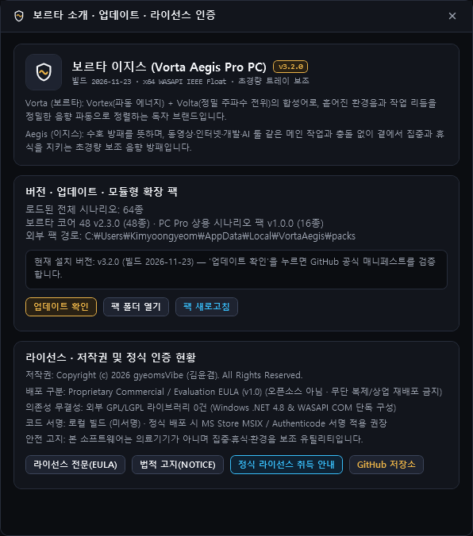

# 03. 실가동 PC 앱 사용법 및 기능 완전 가이드 (`Vorta Aegis Pro PC v3.2.0`)

> **대상**: 프로그래밍이나 음향을 전혀 모르는 일반 Windows 10/11 사용자부터, 나만의 JSON 시나리오 팩을 추가하고 싶은 파워 유저까지 누구나 따라 할 수 있는 실전 매뉴얼입니다.

---

## 1. 1초 만에 설치하고 실행하기 (Windows 10 / 11)

`Vorta Aegis Pro PC` 는 무거운 설치 파일이나 유료 외부 라이브러리, Android Studio 없이도 **Windows에 기본 내장된 `.NET Framework 4.8`** 만으로 그 자리에서 64비트 네이티브 앱을 빌드합니다.

### 준비물
- **Windows 10 또는 Windows 11** (64비트)
- **Python 3** ([python.org](https://www.python.org/) 에서 설치 가능)

### 설치 명령 (GitHub 저장소 루트에서 실행)
```powershell
git clone https://github.com/gyeomsVibe/261020-Vorta-Reso-Frequency-Tone-Generator.git
cd 261020-Vorta-Reso-Frequency-Tone-Generator
python 02-apps/pc-windows-vorta-aegis/install_pc.py
```
- 실행이 끝나면 바탕화면과 시작 메뉴에 **`보르타 이지스`** 바로가기 아이콘이 자동으로 만들어집니다.
- *(참고: 로컬 개발 작업실 폴더 구조에서는 `python vorta_aegis_pc/install_pc.py` 경로로 동작하며, 저장소 내 `sync_presets.py` 가 Android 소스 유무를 자동 감지해 단독 빌드도 막힘없이 처리합니다.)*

---

## 2. 실제 가동 화면 한눈에 보기

### ① 와이드 스튜디오 화면 (PC Pro 40Hz 감마 딥워크 + 좌우 `GridSplitter`)


1. **상단 상태바 (`WASAPI 48k` · 12단 레벨 미터)**: 현재 Windows 사운드카드와 직통으로 주고받는 초고해상도 출력 상태를 실시간 불빛으로 보여 줍니다.
2. **현재 주파수 & 파동 스코프 (`200.00 Hz`, `L/R 차 40.00 Hz`)**:
   - 우측 상단 **`[기본 파동 | 실출력 보기]`** 토글을 누르면 *"스피커 보정 전의 순수 목표 파형"* 과 *"144 Hz 반송파가 합쳐져 스피커로 실제 나가는 파형"* 을 바로 비교해 볼 수 있습니다.
   - 그 아래 4개의 카드(**위상·채널**, **파형·변조**, **PC 음향**, **실출력 레벨**)가 현재 작동 방식을 실시간 요약합니다.
3. **현재 재생 정보 카드 (`핵심 효과` · `추천 활용` · `음향 안내`)**: 어떤 주파수인지 숫자로 외울 필요 없이 *"언제, 어떤 볼륨으로 쓰면 좋은지"* 3줄로 안내하며, `[위치 보기 >]` 를 누르면 우측 카드 목록에서 해당 프리셋으로 자동 스크롤됩니다.
4. **독립 출력 볼륨 (`15%` ~ `120% 증폭` + `-0.5 dBTP 리미터`)**:
   - `15% 영상` / `30% 작업` / `50% 병행` / `80% 단독` / `100% 최대 (0.0 dB)` / `120% 증폭 (+1.6 dB)` 원클릭 버튼.
   - `100%` 를 넘어 **`120% 증폭`** 을 켜도 내부 리미터가 꼭대기 찌그러짐(`클리핑`)을 막아 줍니다.
5. **중앙 세로 구분선 (`GridSplitter`)**: 왼쪽 컨트롤 패널과 오른쪽 목록 사이의 세로 구분선을 마우스로 좌우로 끌면 내 모니터 취향에 맞게 넓이를 자유롭게 조정할 수 있습니다. (닫았다 켜도 마지막 폭을 기억합니다.)

---

### ② 세로 확장 화면 (`7.00 Hz` 안티방어 이중링 스코프 & 하단 세션 모니터)


- **`7.00 Hz` 저주파 정밀 파동**: `1500 Hz` 전용 저주파 링버퍼 덕분에 초저주파 `7.00 Hz` 도 3주기(`428.7 ms`)가 매끄러운 S자 물결로 표시됩니다.
- **세로 여유 공간 `세션 모니터 · 빠른 전환` 독**: 창 높이를 여유 있게 키우면 왼쪽 아래 빈 공간에 **`재생 경과 시간`**, **`활성 출력 장치 이름`**, **`클리핑 0 · -0.5dBTP 정상` 감시 배지**, 그리고 자주 쓰는 프리셋 **`원클릭 빠른 전환`** 버튼들이 자동으로 나타납니다.

---

### ③ 슬림 · 컴팩트 모드 & 미니 플로팅 바 (`전체` 복원 지원)


- 상단 **`[슬림]`** 버튼을 누르면 왼쪽 컨트롤 위주의 작은 세로 창(좁은 창에서는 상하 통합 스크롤)으로 줄어듭니다.
- 상단 **`[미니 바]`** 버튼을 누르면 가로 `372×62` 크기의 초슬림 떠다니는 바만 화면 구석에 남습니다.
  - **원래 큰 창으로 돌아가는 방법 2가지**: 미니바 오른쪽의 **`[전체]`** 버튼을 클릭하거나, 왼쪽 제목 글자 부분을 **더블클릭**하면 즉시 전체 패널로 복원됩니다.
- 창의 **`×` (닫기)** 버튼을 누르면 **재생이 멈추지 않고 Windows 오른쪽 아래 트레이(시계 옆 숨겨진 아이콘)로 들어가 초저메모리로 조용히 계속 재생**됩니다. 앱을 완전히 끄려면 창 오른쪽 아래 빨간색 **`완전 종료`** 글자나 트레이 아이콘 우클릭 메뉴를 이용하세요.

---

### ④ 보르타 소개 · 실시간 업데이트 확인 · 라이선스 인증 창


- 상단 **`[정보]`** 버튼을 누르면 언제든 다음 기능을 쓸 수 있습니다:
  - **브랜드 뜻 & 시나리오 현황**: 코어 `48종` + PC Pro 상용 팩 `16종` (`총 64종`) 로드 확인
  - **`[업데이트 확인]`**: TLS 1.2+ 암호화 통신으로 GitHub의 최신 `version.json` 과 내 PC 버전을 즉시 비교
  - **`[팩 폴더 열기]` / `[팩 새로고침]`**: 나만의 확장 프리셋 JSON 파일을 넣고 1초 만에 불러오기
  - **라이선스 & 정식 인증 문서 열기**: EULA(`LICENSE`), 법적 고지(`NOTICE`), 정식 인증 가이드 바로 열기

---

## 3. 코딩 없이 나만의 프리셋 팩(`.json`) 추가하기

1. 앱 상단 `[정보]` → `[팩 폴더 열기]` 를 클릭합니다. (경로: `%LOCALAPPDATA%\VortaAegis\packs`)
2. 메모장 등으로 `my_custom_pack.json` 파일을 만들고 아래 **`Schema v1`** 양식대로 입력해 저장합니다.
```json
{
  "schemaVersion": 1,
  "packId": "my-focus-pack",
  "packName": "나만의 작업 팩",
  "packVersion": "1.0.0",
  "presets": [
    {
      "id": 2001,
      "shortCode": "M01",
      "tabIndex": 2,
      "title": "나만의 14Hz 집중",
      "badge": "SMR 집중",
      "desc": "오후 문서 작업용 맞춤 바이노럴 비트",
      "freq1": 210.0,
      "freq2": 224.0,
      "isSweep": false,
      "sweepStart": 0.0,
      "sweepEnd": 0.0,
      "sweepDurationSec": 0.0,
      "isAntiPhase": false,
      "binauralBeat": 14.0,
      "noiseType": 4,
      "fmMod": false,
      "fmDepth": 0.0,
      "fmRate": 0.0,
      "amMod": false,
      "amDepth": 0.0,
      "amRate": 0.0
    }
  ]
}
```
> *(`tabIndex` 는 `0=안티방어`, `1=수면`, `2=집중·공부`, `3=명상·안정`, `4=두통·통증`, `5=운동·피로`, `6=기분·힐링`, `7=모기·벌레` 입니다. `noiseType` 은 `0=없음`, `1=핑크`, `2=초음파`, `4=브라운 1/f²`, `5=부드러운 롤오프 마스킹` 입니다.)*
3. 앱에서 **`[팩 새로고침]`** 을 누르면 앱을 껐다 켜거나 다시 컴파일할 필요 없이 곧바로 목록에 나타납니다.

---

## 4. 단축키 및 문제 해결 (`FAQ`)

| 조작 / 상황 | 해결 방법 |
|---|---|
| **키보드 단축키** | `Space`: 재생/정지 · `↑ / ↓`: 볼륨 ±2% · `M`: 음소거 토글 · `Ctrl + F`: 프리셋 검색창 포커스 |
| **미니바에서 전체 창 복원** | `[전체]` 버튼 클릭 또는 제목 표시 영역 더블클릭 |
| **영상 소리를 덮지 않으려면** | `15% 영상` 또는 `30% 작업` 버튼을 쓰시고, PC 스피커라면 `PC 스피커 보정` / 이어폰이라면 `이어폰·헤드폰` 모드를 고르세요. (`이어폰·헤드폰`은 고주파 `-12 dB` 안전 가드가 켜집니다.) |
| **`7.00 Hz` 그래프가 출렁임이 겹쳐 보일 때** | 그래프 우측 상단 버튼이 `기본 파동` 상태인지 확인하세요. (`실출력 보기`는 `144 Hz` 반송파가 합쳐진 실제 스피커 전기 신호를 그대로 보여 줍니다.) |

👉 **다음 추천 읽기**: 문서에 나온 전문용어의 뜻이 헷갈릴 때는 **[04. 전문용어 쉬운 사전 (ELI10 용어집)](04_전문용어_쉬운사전_ELI10_용어집.md)** 를 바로 찾아보세요.
