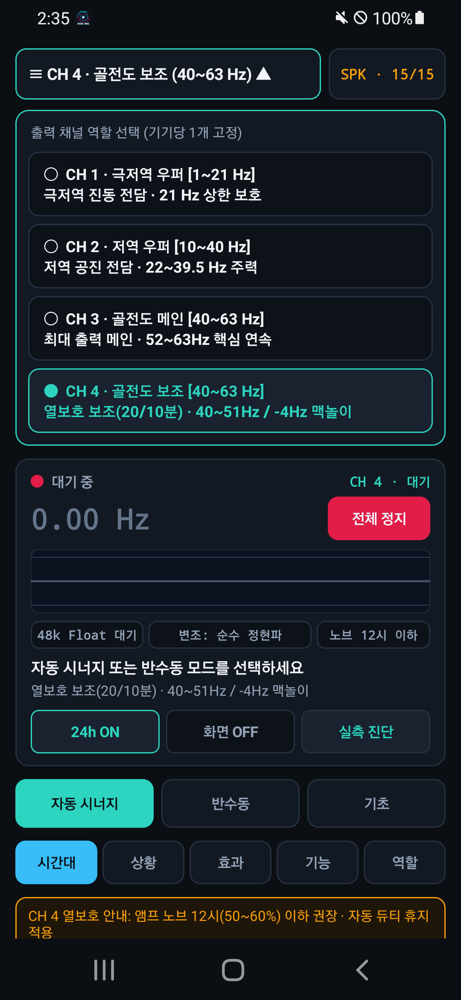
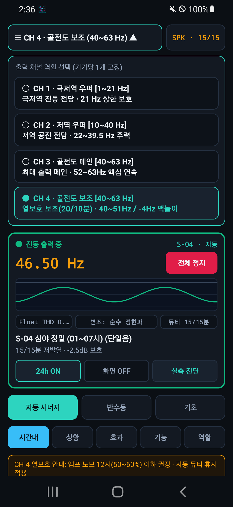
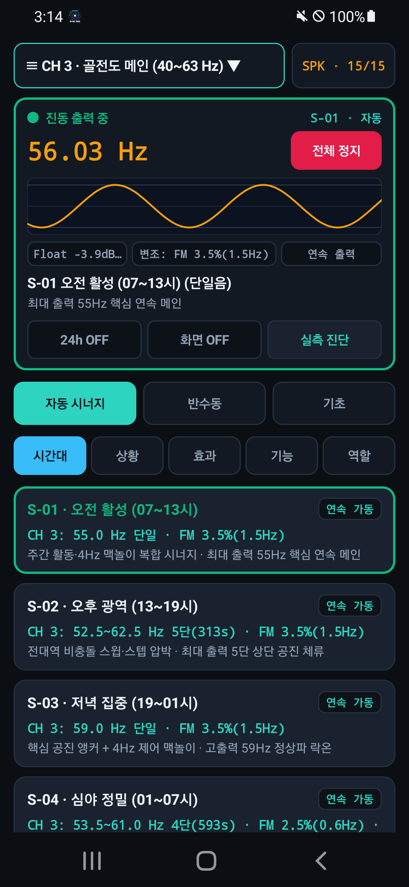
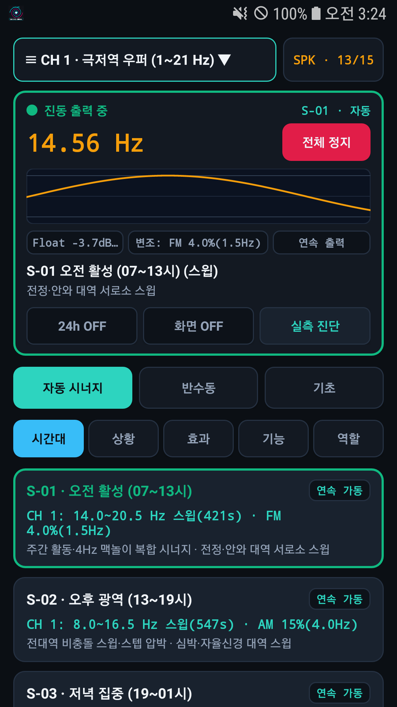
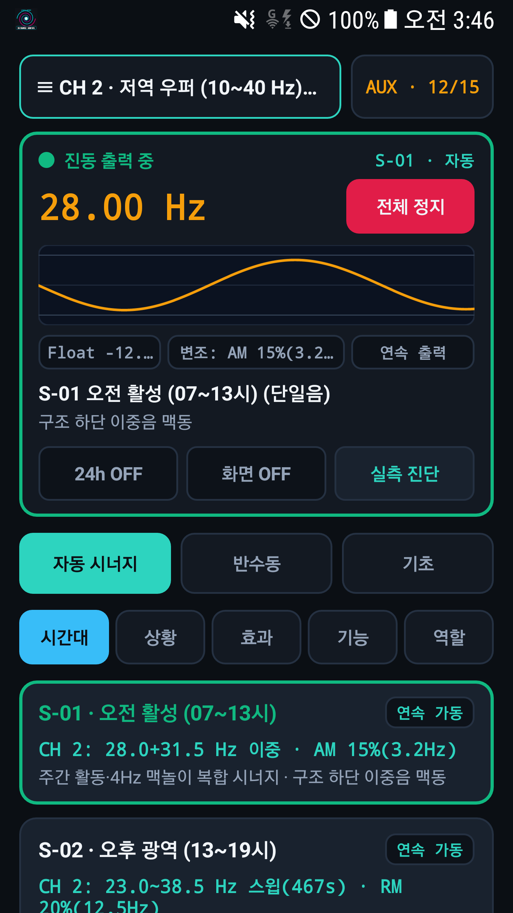
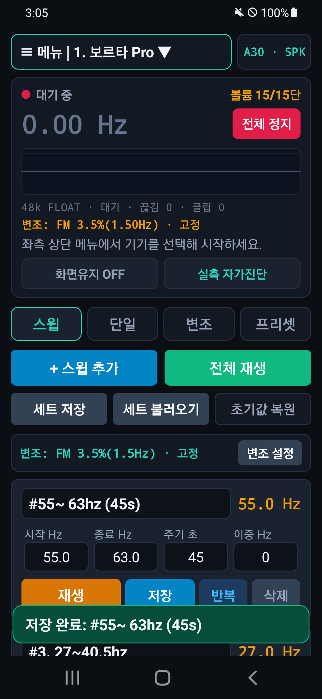
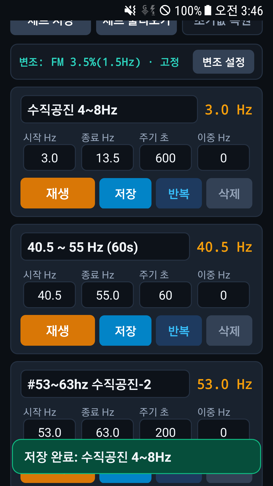

# 05. 4기기 시너지 진단과 해결 과정 완전 정복 (`시너지 v1.1.1` & `구버전 통합 v5.2.1`)

> **이 문서의 핵심**: *"스마트폰 4대를 동시에 틀면 소리가 겹쳐서 오히려 약해지지 않나요?"*, *"왜 본카운터 A30은 12시 넘기면 뜨거워지고 트랜스 A30이 메인인가요?"*, *"S7·S6에서 스윕 저장 알림이 안 뜨고 화면이 위아래로 튕겨요"*, *"구버전 A30에 볼륨 몇 단계인지 안 보이고 글씨 크기는 크게 유지하고 싶어요"* 같은 **실제 4기기 실전 운용 중 제기된 8대 핵심 과제**를 어떻게 진단하고 해결했는지, **초보자 눈높이(`ELI10`)** 와 **엔지니어 검증 근거(`Deep-Dive`)** 를 1:1로 짝지어 정리한 완결판입니다.

---

## 1. 3분 요약: 4기기 동시 가동 시 물리적으로 무슨 일이 일어나며 어떻게 이기는가?

### ① 핵심 음향 원리 4가지 (`ELI10` + 전문용어 병기)

1. **`위상 상쇄 (Phase Cancellation, 두 물결이 엇갈려 힘이 빠지는 현상)`**:
   - **쉬운 비유**: 그네를 두 사람이 동시에 밀어주려는데, 시계가 `0.01초`만 어긋나도 한 명이 앞으로 밀 때 다른 한 명이 뒤로 잡아당겨 그네가 멈춰 버립니다.
   - **과학적 결론**: 서로 다른 폰 4대는 내부 전자시계(`Audio Clock`, 오디오 클록)가 완벽히 맞물리지 않아, **4대에 똑같은 단일 주파수(예: `55 Hz` 하나)를 틀면 공간 위치마다 마루(+)와 골(-)이 만나 힘이 깎이는 `사각지대(Dead Spot)`가 생깁니다.**
2. **`임계대역 분할 (Critical-Band Partitioning, 각자 잘 뛰는 운동장 칸을 나눠 맡기기)`**:
   - **해법**: 똑같은 칸에서 자리싸움을 시키지 않고, **인간 귀·몸의 감각 필터(`Bark Scale`, 바크 척도)와 각 앰프·스피커의 물리 한계에 맞춰 4개의 겹치지 않는 전용 주파수 구간**을 나눕니다.
   - **시너지 효과**: 서로 다른 대역을 맡으면 에너지가 `±`로 상쇄되지 않고 **제곱합(`RMS` 합산, 비간섭 에너지 중첩)** 으로 쌓이며, 동시에 **4기기가 약점 없이 전 대역을 덮습니다.**
3. **`4 Hz 제어 맥놀이 (Controlled Beating, 두 파동 차이로 규칙적인 두근거림 만들기)`**:
   - **쉬운 비유**: 운동장 옆 트랙에서 `55걸음/초(CH 3)`와 `51걸음/초(CH 4)`로 나란히 뛰면, **매초 딱 4번씩(`55 - 51 = 4 Hz`) 발맞춤이 겹치며 강력한 쿵·쿵·쿵 맥동**이 생깁니다.
   - **효과**: `4 Hz` 부근은 인간 감각이 가장 크게 느끼는 변동 강도(`Fluctuation Strength`, 변동 강도) 정점입니다. 시너지 없이 똑같이 `55 Hz` 를 트는 것보다 **작은 앰프 열부하로도 훨씬 높은 체감 타격**을 만듭니다.
4. **`서로소 주기 (Coprime Sweep Periods, 만나는 날이 안 겹치게 톱니바퀴 돌리기)`**:
   - **쉬운 비유**: `CH 1` 스윕 주기를 `421초`, `CH 2`를 `467초`, `CH 3`를 `313초`처럼 **서로 나뉘지 않는 소수(`Prime` / `Coprime`)** 로 잡으면, 4기기가 언제든 매초 새로운 조합을 만들어 **상대방의 `감각 습관화(Habituation, 같은 자극에 무뎌지는 내성)`** 를 원천 차단합니다.

### ② 4기기 물리 역할 분담표 (`v1.1.1` 최종 확정 정본)

| 채널명 | 연결 기기 · 앰프 | 물리 한계와 원인 | 최종 담당 주파수 & 출력 정책 | 실기기 시리얼 (검증 완료) |
|---|---|---|---|---|
| **`CH 1 · 극저역 우퍼`** | 갤럭시 S7 + 우퍼 | `21 Hz` 초과·최대 볼륨에서 콘지 떨림·찢어짐 소음 | **`1.0 ~ 21.0 Hz`** 하드 클램프 · `2.0s` 소프트스타트 · 양단 변위 감쇄 | `ce021602916dbb3804` (`Android 8.0`) |
| **`CH 2 · 저역 우퍼`** | 갤럭시 S6 + 하자 우퍼 2기 | 하자 우퍼 2기 병렬 결선으로 임피던스·과열 부담 | **`10.0 ~ 40.0 Hz`** 하드 클램프 (주력 `22~39.5 Hz`) · 기본 `-1.5 dB` · `34 Hz`↑ 추가 감쇄 | `06157df622d5ad1d` (`Android 7.0`) |
| **`CH 3 · 골전도 메인`** | **트랜스용 A30 + 트랜스 앰프** | 내구성·방열 우수, 조절 다이얼 풍부 (**최대 출력 메인**) | **`52.0 ~ 63.0 Hz` 핵심 연속 메인 (`0 dB` 풀 헤드룸)** · 4Hz 맥놀이 기준 | `R59N303R80N` (`Android 11`) |
| **`CH 4 · 골전도 보조`** | **본카운터 A30 + Class-AB 앰프** | 볼륨 노브 `12시` 초과 시 급발열(Kinter MA-170 열차단 위험) | **`40.0 ~ 51.0 Hz` / `CH3 - 4 Hz` 보조** · 기본 `-2.0 dB` + RC 열감쇄 + `20/10`·`15/15분` 휴지 | `R59N105TEYF` (`Android 11`) |

---

## 2. 8대 문제 진단 및 해결 사례 (`Structured Few-Shot Case Studies`)

> 아래 8개 사례는 모두 **`① 사용자 증상 → ② 초보자 눈높이 원인 진단(ELI10 + 전문용어) → ③ 전문가 해결 설계(Deep-Dive) → ④ 실측 검증 증거 → ⑤ 체감 변화`** 의 5단계 구조로 정리되어 있습니다.

---

### 사례 1. 4기기 동시 가동 위상 상쇄 & 주파수 내성 문제 → `20×4 시너지 패키지` 탄생

- **① 사용자 증상**: 4대에 같은 주파수를 틀자니 서로 부딪혀 약해질 것 같고, 앰프를 늘리자니 끝이 없으며, 같은 소리만 계속 틀면 상대가 금세 적응(내성)합니다.
- **② 초보자 눈높이 원인 진단 (`ELI10` + 전문용어)**:
  - **내성(`Acoustic Habituation`, 음향 습관화)** 이란, 시계 초침 소리를 10분만 들으면 귀와 뇌가 *"이건 변화 없는 배경 소리"* 라고 판단해 스위치를 꺼버리는 현상입니다.
  - 이를 깨려면 **주파수 충돌(`Band Overlap`)은 0으로 막고, 시간대·상황·변조(`FM/AM/RM`)와 `미세 주파수 떨림(Jitter)`** 을 서로 다른 `서로소(Coprime)` 주기로 섞어야 합니다.
- **③ 전문가 해결 설계 (`Deep-Dive`)**:
  - `SynergyCatalog.java` 에 **시간대(4) · 상황(4) · 효과(4) · 기능(4) · 역할(4) = `20개 패키지 × 4채널 = 80개 프로그램` (`S-01`~`S-20`)** 설계.
  - 각 패키지 내부의 4채널이 **한 Hz도 겹치지 않도록** 비충돌 검사(`rangesOverlap == false`), 전 스윕 주기 **쌍별 서로소 검사(`gcd(d1, d2) == 1`)**, `-1.0 dBTP (0.89125)` **유클리드 피크 리미터(`SynergyDspCore.java`)** 를 수학적으로 잠금.
- **④ 실측 검증 증거**:
  - 호스트 JVM 자동 감사 `TestVortaSynergyAudit`: `Gate1_PackageCount20` (`20패키지`, `0위반`), `Gate2_ZeroCollisionAndCoprime` (`collisions=0, nonCoprimeSweeps=0`), `Gate3b_Dsp102ParityAndVaccine` (`worstPureTHD=0.000003%, maxPeak=0.89125`) PASS.
- **⑤ 체감 변화**: 사용자는 4대 기기에서 똑같이 **`S-01`**(또는 **`24h ON`**)만 누르면 4기기가 한 몸처럼 안 겹치고 알아서 협연합니다.

---

### 사례 2. 골전도 메인·보조 역전 보정 (`v1.1.0 → v1.1.1`) — 트랜스 `CH 3` 주력 · 본카운터 `CH 4` 보조

- **① 사용자 증상**: 골전도 A30 2기 중 실제로 내구성과 최대 출력을 담당하는 메인은 **트랜스 앰프**이고, **본카운터(Kinter MA-170)** 는 열에 약해 보조로 돌려야 하는데 초기 버전(`v1.1.0`) 일부 시나리오에서 상단 주력(`52~63 Hz`)이 `CH 4`에 배치되어 있었습니다.
- **② 초보자 눈높이 원인 진단 (`ELI10` + 전문용어)**:
  - **힘센 말(`트랜스`, 방열 우수)과 숨 찬 말(`본카운터`, `12시` 넘으면 발열)** 이 반대로 짐을 지면, 힘센 말은 노는데 약한 말이 먼저 퍼져서 앰프 **`열차단 보호(Thermal Shutdown)`** 에 걸립니다.
- **③ 전문가 해결 설계 (`Deep-Dive`)**:
  - `SynergyChannel.java` / `HardwareStabilizer.java` / `SynergyCatalog.java` 전면 정렬(`v1.1.1`):
    - **`CH 3 · 골전도 메인`**: `52.0 ~ 63.0 Hz` 핵심 고출력 연속 담당, `baseTrimDb = 0.0 dB` (풀 헤드룸 연속 운전).
    - **`CH 4 · 골전도 보조`**: `40.0 ~ 51.0 Hz` 또는 `CH3 - 4.0 Hz` 4Hz 맥놀이 담당, `20분 가동/10분 휴지` 또는 `15분/15분` 냉각 듀티(`Duty Cycle`) 전 20패키지 필수 탑재 + Class-AB 1차 `RC 열모델` 자동 감쇄.
- **④ 실측 검증 증거**:
  - `TestVortaSynergyAudit` `Gate4_ThermalDutyGovernor` (`ch4Missing=0, coolAbs=0.000000, maxDelta=0.00473`), `Gate8` (`ch3Main=true, thermalLoad=0.86 → derate=-1.84 dB`) PASS + 본카운터 A30(`CH 4`)·트랜스 A30(`CH 3`) 실기기 교차 출력 확인.
- **⑤ 체감 변화**: 트랜스 앰프가 지치지 않고 중심 타격을 끌고 가며, 본카운터 앰프는 발열 선을 넘지 않고 `+4 Hz` 맥놀이 시너지에만 안전하게 힘을 보탭니다.

---

### 사례 3. 갤럭시 S7·S6 스윕 저장 무반응 & 연속 저장 시 스크롤 튕김 해결 (`v1.1.1` + `v5.2.1`)

- **① 사용자 증상**: 갤럭시 S7(Android 8.0)과 S6(Android 7.0)에서 스윕 `저장` 버튼을 눌러도 저장 팝업이 안 뜨고, 연속 저장을 누르면 화면 스크롤이 제멋대로 위아래로 튕겨 올라갔다 내려갔다 했습니다.
- **② 초보자 눈높이 원인 진단 (`ELI10` + 전문용어)**:
  1. **시스템 팝업(`Toast`) 증발**: Android 7/8은 알림 권한·포커스 충돌 시 앱 바깥에 뜨는 `Toast.makeText` 안내창을 조용히 삼켜 버립니다.
  2. **키보드 포커스 납치(`AdjustPan + ScrollView Focus Jump`)**: 목록 카드 안에 입력칸(`EditText`)이 여러 개 있을 때 화면을 다시 그리면 Android가 가장 가까운 입력칸으로 **시선을 강제 점프**시킵니다.
  3. **저장 완료 확인 부재**: 기존 `apply()` / `void saveNow()` 대신 즉시 디스크에 기록 후 성공 여부를 돌려주는 **동기 `.commit()`** 확인이 필요했습니다.
- **③ 전문가 해결 설계 (`Deep-Dive`)**:
  - `Toast.makeText` **전면 삭제** → 루트 **`FrameLayout` 하단 인앱 배너(`showBanner`)** 로 교체(알림 설정과 무관하게 100% 표시).
  - 매니페스트 `windowSoftInputMode="adjustResize"`, 루트 `FOCUS_BEFORE_DESCENDANTS`, 저장 전 `clearFocusAndHideKeyboard()` + `savedScrollY` 기록 후 `post(scrollTo(0, savedScrollY))` 로 화면 위치 못 박기.
  - `SweepStore.saveNow` / `saveNamedSet` 이 `.commit()` 의 `boolean` 결과를 직접 반환하도록 개조.
- **④ 실측 검증 증거**:
  - **S7(`ce021602916dbb3804`) 실기**: `#취침-신체 18~25hz` `저장` 2연타 → **`저장 완료: #취침-신체 18~25hz`** 녹색 배너 표시 + `저장` 버튼 Y좌표 **`683 → 683` (`0 px` 점프)**.
  - **S6(`06157df622d5ad1d`) 실기**: `수직공진 4~8Hz` `저장` 2연타 → **`저장 완료: 수직공진 4~8Hz`** 배너 + **`1018 → 1018` (`0 px` 점프)**.
  - **A30(`R59N105TEYF`) 실기**: `#55~ 63hz (45s)` `저장` 2연타 → **`저장 완료: #55~ 63hz (45s)`** 배너 + **`1992 → 1992` (`0 px` 점프)**.
- **⑤ 체감 변화**: 어느 기기에서든 저장을 연속으로 눌러도 화면이 꿈쩍하지 않고, 초록색 확인 배너가 즉시 떠서 안심하고 작업할 수 있습니다.

---

### 사례 4. 구버전 통합앱 A30 볼륨 표시 복구 · 내부 용어 정리 · **시력 보호용 글씨 크기 100% 유지 (`v5.2.1`)**

- **① 사용자 증상**: 구버전 통합앱 A30에서는 우측 상단에 `볼륨 xx/15단` 대신 `"순음 고정(볼륨 무개입)"` 같은 내부 작업용 단어가 떴습니다. 단, 고칠 때 **시력 때문에 기존 글씨 크기는 절대 작게 줄이지 말라**는 조건이 붙었습니다.
- **② 초보자 눈높이 원인 진단 (`ELI10` + 전문용어)**:
  - 기존 코드 `buildGuardStatusText()` 가 *"볼륨을 강제로 조절하지 않는 기기(`A30`)는 볼륨 숫자도 읽지 말자"* 고 잘못 묶여 있었습니다.
  - **"볼륨 숫자를 화면에 보여 주는 것(`Read-Only Display`, 읽기 전용 조회)"** 과 **"볼륨을 강제로 바꾸는 것(`OS Volume Write`, 시스템 쓰기 개입)"** 은 완전히 별개입니다!
- **③ 전문가 해결 설계 (`Deep-Dive`)**:
  - `VortaVolumeGuard.formatLiveVolumeStepText()` 신설: `AudioManager.getStreamVolume(STREAM_MUSIC)` / `getStreamMaxVolume()` 으로 **읽기만 수행**해 `볼륨 15/15단` 실시간 표시 (`A30` 볼륨 쓰기 `0건` 불변, 브로드캐스트 수신기 `VOLUME_CHANGED_ACTION` 즉시 반영).
  - 신규 `보르타 시너지` 앱에서는 우측 상단에 `SPK · 15/15` / `AUX · 12/15` 배지를 넣고 `"자유볼륨"`·`"해당없음"` 등 내부 용어를 100% 상용 문구로 교체.
  - 구버전 `v5.2.1` `MainActivity.java` 에서는 **기존 68개의 `setTextSize(...)` 호출을 단 1줄도 변경/축소하지 않음.**
- **④ 실측 검증 증거**:
  - `TestVortaUnifiedV521Audit` `Gate4_PreserveExistingFontSizes`: `oldCount=68, newCount=69, delta=[mTvBanner.setTextSize(13);]` → 기존 글씨 크기 100% 무손상 통과.
  - 실기 검증: 본카운터 A30 `볼륨 15/15단`, 트랜스 A30 `볼륨 15/15단`, S7 `볼륨 13/15단`, S6 `볼륨 12/15단` (OS `STREAM_MUSIC` 변경 `0건`).
- **⑤ 체감 변화**: 눈이 편한 큰 글씨와 익숙한 스윕 목록(`#55~ 63hz` 등)은 그대로 두면서도, 4대 모두 한눈에 현재 볼륨 단계를 읽을 수 있게 되었습니다.

---

### 사례 5. 글자 잘림 및 불규칙 줄바꿈 제거 (`UI/UX 균형 줄바꿈`)

- **① 사용자 증상**: 긴 시나리오 설명이나 노브 안내 문장이 한 줄 끝에서 `...` 으로 잘리거나 어색하게 끊어져 정보 파악을 방해했습니다.
- **② 초보자 눈높이 원인 진단 (`ELI10` + 전문용어)**:
  - 글자를 무조건 한 줄(`setSingleLine(true)`) 안에 억지로 구겨 넣으면 긴 문장은 뒤가 잘립니다. 반대로 줄바꿈 규칙 없이 2줄로 풀면 마지막 줄에 1~2글자만 외롭게 떨어지는 **`외톨이 줄 현상(Widow/Orphan Wrapping)`** 이 생깁니다.
- **③ 전문가 해결 설계 (`Deep-Dive`)**:
  - 구버전 `MainActivity.java` (`v5.2.1`): 폰트 크기는 건드리지 않고 `applyBalancedWrap(tv, 2)` (`maxLines=2` + `lineSpacing=2dp` + Android 6+ `Layout.BREAK_STRATEGY_BALANCED`, **단어 폭을 균등 배분해 두 줄의 길이를 고르게 맞추는 레이아웃 엔진**) 적용.
  - 신규 `vorta_synergy_app` (`v1.1.1`): `TypedValue.COMPLEX_UNIT_DIP` 로 폰트 배율 팽창을 막고, 상태 칩(파이프라인 · 변조 · 출력)을 3분할해 가독성 확보.
- **④ 실측 검증 증거**:
  - `TestVortaSynergyAudit` `Gate6_CommercialAndBugRegression` (`banned=[]`) PASS + 트랜스 A30 `v5.2.1` 실기 캡처에서 `권장 노브: LP-168S...` 2줄 균형 줄바꿈 확인.
- **⑤ 체감 변화**: 설명 문장이 중간에 잘려 궁금할 일 없이 시원하게 2줄 안에 보기 좋게 들어옵니다.

---

### 사례 6. 불안정 하드웨어(찢어짐·병렬 부하·발열·배터리) 보정 및 보호 엔진 (`HardwareStabilizer`)

- **① 사용자 증상**: S7 우퍼(`>21 Hz` 잡음), S6 하자 우퍼 2기 병렬(`10~40 Hz`), 본카운터 Class-AB 앰프(`12시`↑ 발열), 구형 스마트폰 장기 충전 배터리 부풀어 오름(`Swelling`) 위험을 앱과 시스템 양쪽에서 막아야 했습니다.
- **② 초보자 눈높이 원인 진단 (`ELI10` + 전문용어)**:
  - **초기 충격 완화(`Soft-Start`, 부드러운 출발)**: 자동차 액셀을 갑자기 밟으면 바퀴가 헛돌듯, 전기를 확 넣으면 스피커 코일이 덜컹거립니다. 처음 `1.8~2.0초` 동안 0%에서 100%까지 매끄럽게 올립니다.
  - **특정 잡음 구간 피해가기(`Rattle Notch`, 덜덜거림 회피 노치)**: 특정 주파수(예: `36 Hz`)에서만 스피커가 떨린다면, 그 주변 폭만 `-12 dB` 로 쏙 파내어 부드럽게 지나갑니다.
  - **1차 `RC 열모델` (`Thermal RC Model`)**: 주전자가 끓기 시작하면 온도가 서서히 올라가고 끄면 서서히 식는 물리 법칙을 앱이 실시간 계산해, 과열 부하 `65%` 를 넘기면 출력을 자동으로 최대 `-3.0 dB` 낮춥니다.
- **③ 전문가 해결 설계 (`Deep-Dive`)**:
  - `HardwareStabilizer.java`: `CH 1`(`2.0s` 소프트스타트 + 양단 `-2.0/-2.5 dB`), `CH 2`(`2.0s` + `-1.5 dB` 기본 + 상단 `-3.0 dB`), `CH 3`(`0 dB` 연속 메인), `CH 4`(`-2.0 dB` + `tauHeat=600s / tauCool=300s` RC 감쇄), 배터리 온도 **`43.0°C` 이상 `-3.0 dB` / `39.0°C` 미만 해제 히스테리시스**.
  - 설치 스크립트 보호 정책: `protect_battery=1` (`85%` 충전 제한), 고속충전 OFF(`adaptive_fast_charging=0`), `stay_on_while_plugged_in=0` (화면 자동 꺼짐 허용).
- **④ 실측 검증 증거**:
  - `TestVortaSynergyAudit` `Gate8_UnstableHardwareStabilizer`: `load=0.86 → derate=-1.84 dB`, 무음 냉각 후 `cool=0.12`, 고온 순음 `THD+N=0.002957%`, `Notch -12.0 dB`, `43.2°C/41.0°C/38.9°C` 히스테리시스 전량 PASS.
- **⑤ 체감 변화**: 장시간 무인 가동에도 스피커 찢어짐·앰프 열차단·배터리 팽창 걱정이 크게 줄어듭니다.

---

### 사례 7. S7(Android 8.0) & S6(Android 7.0) 안전볼륨 해제 5대 레드팀 감사 및 실물 유선 검증

- **① 사용자 증상**: 기존 안전볼륨 해제가 현재 동작은 하지만, 장시간·예외 상황에서도 절대 풀리지 않고 믿을 수 있는지 비판적 재점검이 필요했습니다.
- **② 초보자 눈높이 원인 진단 (`ELI10` + 전문용어)**:
  - **안전볼륨(`Safe Media Volume`)** 은 유선 이어폰/AUX 를 꽂고 `20시간(`mMusicActiveMs=72,000,000ms`)` 이 지나거나 재부팅할 때 Android가 강제로 볼륨을 `9/15` (`60%`) 로 깎아 내리는 기능입니다.
  - 레드팀(의도적으로 빈틈을 공격해 보는 검사 팀) 감사 결과 **5가지 잠재 함정**을 찾아냈습니다:
    1. 잠금 화면 재시도 `3회` 실패 시 다음 AUX 재연결 전까지 영구 정지 위험
    2. 사용자가 직접 볼륨 버튼으로 `10 → 9` 를 내렸는데 OS가 강제 클램프한 줄 알고 다시 `10` 으로 올려 버릴 위험
    3. S6 부팅 시 이미 해제(`state=2`) 상태인데도 시스템 설정을 불필요하게 건드림
    4. 구·신 앱 공존 시 `.SafeVolAuth` 임시 권한 찌꺼기 남을 가능성
    5. 한국어 경고창 문구(`"음량 제한"`, `"최대 음량"`) 누락 시 접근성 클릭 지연
- **③ 전문가 해결 설계 (`Deep-Dive`)**:
  - **5대 보강 (`SynergyVolumeGuard` / `VortaVolumeGuard` + `AccessibilityService`)**: ① **5분(`300초`) 쿨다운 후 재시도 카운터 자동 리셋**, ② `safeState==2` 에서 `10→9` 1단 수동 하향 존중 (`isOsSafeVolumeClamp`), ③ 이미 `state=2` & 언클램프 시 Direct-Binder 스킵, ④ `finally` 블록에서 `sanitizeRestoredControllerComponent` 로 `.SafeVolAuth` 찌꺼기 null 정화, ⑤ 키워드 `22종` 확장 + `4500ms` 능동 스캔.
  - **실물 유선(AUX 빈 선) 실기기 검증에서 추가 발견한 OS 함정 (`uiautomator` vs Android 7.0)**: S6(Android 7.0) 에서 UI 테스트 도구(`uiautomator dump`)를 돌리면 OS가 일시적으로 `enabled_accessibility_services` 를 비워 버림 → 테스트/설치 마지막에 반드시 접근성 서비스를 재바인딩해 `bound services: 2` 확인 완료.
- **④ 실측 검증 증거 (`S7` + `S6` 유선 `headphone` 실측)**:
  - **S7 (`ce021602916dbb3804`)**: `12→13` 키 제어 OK, 수동 `10→9` 유지(`9`) OK, 클램프 `13→9→13` 즉시 복원 OK, 화면 꺼짐 후 복원(`13`) 및 `12/15` 복귀 OK (`SAFE_MEDIA_VOLUME_INACTIVE`). *(참고: 화면 꺼짐 테스트 중 패턴 잠금이 걸려 유선 UI 배지 스크린샷 검증만 잠금 해제 대기)*
  - **S6 (`06157df622d5ad1d`)**: `12→13` 키 제어 OK, 수동 `10→9` 유지(`9`) OK, 클램프 `13→9→13` 즉시 복원 OK, 강제 잠금(`state=3`, `9/15`) → **Direct-Binder 즉시 해제(`state=2`, `ctrl_comp='null'`, `13/15`)** 후 `12/15` 복귀 및 접근성 2종 `bound` 확인 OK.
- **⑤ 체감 변화**: S7·S6 모두 유선 AUX 가 연결된 상태에서 사용자가 원하면 `9→10` 이든 `10→9` 든 자유롭게 조절되고, OS가 억지로 `9` 로 깎으면 즉시 원래 볼륨으로 되살립니다.

---

### 사례 8. 실기기 배포 중 직접 잡아낸 숨은 결함 2건 즉시 수정 (UI 프레임 멈춤 & 서명 불일치)

- **① 사용자 증상**: ① 첫 A30 실기 검증 때 Android UI 덤프 도구가 `ERROR: could not get idle state.` 로 타임아웃되었고, ② 구버전 통합앱 `v5.2.1` 덮어쓰기 설치 시 `INSTALL_FAILED_UPDATE_INCOMPATIBLE` (서명 불일치) 오류가 발생했습니다.
- **② 초보자 눈높이 원인 진단 (`ELI10` + 전문용어)**:
  1. **무한 붓질(`Idle Redraw Churn`)**: 대기 중인데도 화면이 `0.65초`마다 글자·배경·파형 캔버스를 새로 그려 대니, Android가 *"지금 화면 바쁘네"* 하며 대기 상태(`Idle`)에 못 들어갔습니다.
  2. **열쇠 꾸러미 착오(`Keystore Path Mismatch`)**: 예전 폴더명(`d:\D_Workspace_NB\주파수\smato_a30_app\debug.keystore`)이 없어지자 빌드 스크립트가 다른 기본 키스토어(`.android\debug.keystore`)로 서명했고, Android는 *"원래 도장과 달라서 기존 스윕 데이터를 엎으면 안 된다"* 며 설치를 막았습니다. 삭제 후 재설치하면 사용자 스윕이 날아가는 상황!
- **③ 전문가 해결 설계 (`Deep-Dive`)**:
  - `MainActivity.java`: `setTextIfChanged()`, 색상·배경 캐시(`mLastTeleBorderColor`, `mLastLedColor`), `mScopeView.invalidate()` 를 재생 중일 때만 실행, 대기 폴링 `2000ms` 완화로 **대기 중 CPU·프레임 재그리기 0건** 달성.
  - `build_unified.py`: 하드코딩 절대경로를 **`os.path.join(os.path.dirname(APP_DIR), "smato_a30_app", "debug.keystore")`** 상대 경로로 수정해 원본 서명 키스토어로 서명.
- **④ 실측 검증 증거**:
  - 전 기기(A30 2대·S7·S6) `uiautomator dump --compressed` 타임아웃 `0건`, 그리고 **모든 기기에서 구버전 사용자 스윕 데이터(`#55~ 63hz (45s)`, `#취침-신체 18~25hz`, `수직공진 4~8Hz`) 100% 무손실 보존 덮어쓰기 설치 성공**.
- **⑤ 체감 변화**: 앱 대기 중 배터리·발열 부담이 줄고, 기존 앱을 지우지 않고도 안전하게 기능만 업데이트했습니다.

---

## 3. 실가동 4기기 최종 검증 성적표 & 실제 화면 캡처

| 구분 | 기기 (시리얼 · OS) | 시너지 앱 (`com.vorta.synergy`) | 구버전 통합 (`com.vorta.unified`) | 핵심 실측 검증 결과 | 크래시 |
|---|---|---|---|---|---|
| **본카운터 골전도** | A30 (`R59N105TEYF` · Android 11) | `v1.1.1` (`111`) · **`CH 4 · 골전도 보조`** | `v5.2.1` (`521`) · **`볼륨 15/15단`** | `S-01` `51.0Hz`/`S-04` `46.50Hz` `48kHz Float`, `TestSet111` 영속, 저장 배너·무점프(`1992→1992`), 스윕 보존 | **0건** |
| **트랜스 골전도** | A30 (`R59N303R80N` · Android 11) | `v1.1.1` (`111`) · **`CH 3 · 골전도 메인`** | `v5.2.1` (`521`) · **`볼륨 15/15단`** | `S-01` `56.03Hz`(`FM 3.5%`, `48kHz Float`), `SPK · 15/15`, 2줄 균형 줄바꿈, OS 볼륨 쓰기 `0건` | **0건** |
| **저역 우퍼 #1** | S7 (`ce021602916dbb3804` · Android 8.0) | `v1.1.1` (`111`) · **`CH 1 · 극저역 우퍼`** | `v5.2.1` (`521`) · **`볼륨 13/15단`** | `S-01` `14.56Hz`(`FM 4.0%`, `48kHz Float`), `저장 완료` 배너·무점프(`683→683`), 유선 `10→9` 유지·`13→9→13` 복원 | **0건** |
| **저역 우퍼 #2** | S6 (`06157df622d5ad1d` · Android 7.0) | `v1.1.1` (`111`) · **`CH 2 · 저역 우퍼`** | `v5.2.1` (`521`) · **`볼륨 12/15단`** | `S-01` `28.00Hz`(`AM 15%`, `48kHz Float`), `수직공진 4~8Hz` 저장 무점프(`1018→1018`), `state=3→2` Direct-Binder 해제, 접근성 2종 `bound` | **0건** |

### 실제 동작 화면 갤러리

````carousel

<!-- slide -->

<!-- slide -->

<!-- slide -->

<!-- slide -->

<!-- slide -->

<!-- slide -->

````

---

## 4. `Self-Refine & Optimize` 비판적 자체 감사 (남은 위험 및 정직한 한계)

| 항목 | 현재 확인 상태 | 사용자에게 알리는 정직한 유의사항 |
|---|---|---|
| **S7 유선 `AUX` UI 화면** | 백그라운드 오디오·안전볼륨 해제 (`12→13`, `10→9`, `13→9→13`, `12` 복귀) **통과 확인** | 화면 끔 테스트 후 **패턴 잠금**이 걸려 유선 상태 상단 `AUX` UI 스크린샷만 미촬영 상태(기능 동작에는 지장 없음) |
| **S7 · S6 `20시간` 누적 타이머** | S7 `63,120,000 ms` (`17.5h`), S6 `64,200,000 ms` (`17.8h`) | 약 2~2.5시간 유선 가동 뒤 Android가 20시간 안전볼륨 재잠금을 발동할 수 있으며, 이때 **양 앱 접근성 자동 확인 + 강제 해제**가 개입 |
| **본카운터 앰프 물리 노브** | 소프트웨어 `-2 dB` + `RC 열감쇄` + `20/10분` 휴지 적용 완료 | Kinter MA-170 물리적 한계상 본카운터 앰프 본체 볼륨 노브는 반드시 **12시(50~60%) 이하** 로 유지 권장 |
| **무인 장기 운용 점검** | 전 기기 `protect_battery=1` (`85%`), 고속충전 OFF, `stay_on=0` | 물리 케이블 접촉 불량 및 앰프 전원·발열 상태는 주기적으로 육안 확인 필요 |

---

## 바로가기

- **실사용 매일 운영 매뉴얼**: [06. 실가동 4기기 보르타 시너지 및 통합앱 사용 매뉴얼](06_실가동_4기기_보르타_시너지_및_통합앱_사용매뉴얼.md)
- **낯선 용어 찾아보기**: [04. 전문용어 쉬운 사전 (`ELI10` 용어집)](04_전문용어_쉬운사전_ELI10_용어집.md)
- **공학 근거 설계서 & 최종 성적표**:
  - [보르타 시너지 4기기 통합운용 음향근거 및 기능설계서](../04-docs/01-architecture-and-design/보르타_시너지_4기기_통합운용_음향근거_및_기능설계서.md)
  - [4기기 실가동 배포 및 안전볼륨 최종검증보고서 (`v1.1.1` & `v5.2.1`)](../04-docs/03-device-engineering-and-reports/4기기_실가동_배포_및_안전볼륨_최종검증보고서_v1.1.1_v5.2.1.md)
