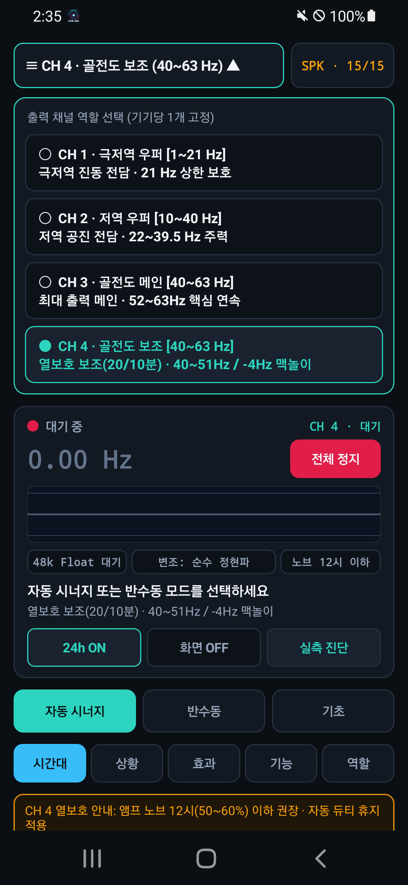
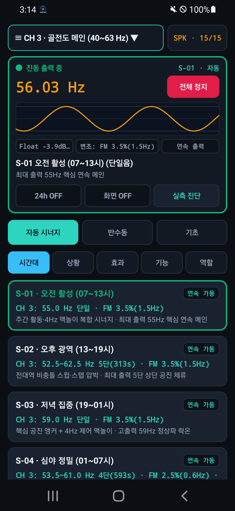
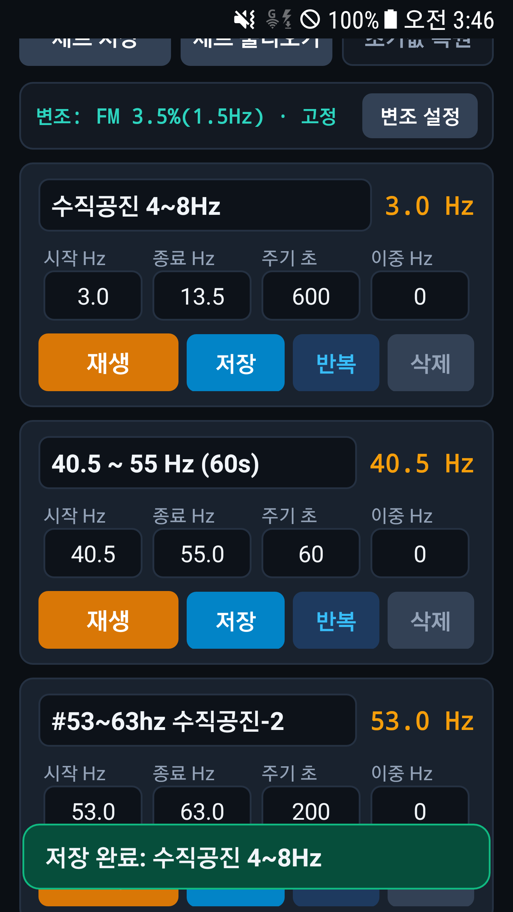

# 06. 실가동 4기기 보르타 시너지(`v1.1.1`) & 구버전 통합앱(`v5.2.1`) 사용 매뉴얼

> **가장 먼저 읽을 1줄**: 4대의 스마트폰에 이미 **`보르타 시너지 v1.1.1`** 과 **`보르타 통합 v5.2.1`** 이 나란히 설치·검증 완료되어 있습니다. 이 매뉴얼은 **전문 지식이 없어도 매일 버튼을 누르고 상황을 바꿀 수 있도록** 만든 실전 안내서입니다.

---

## 1. 4대 스마트폰 · 앰프 1:1 짝꿍 & 채널 고정표

앱 왼쪽 맨 위 **`[≡ CH ...]`** 버튼을 눌러 각 기기에 맞는 채널을 **최초 1회**만 선택하면 앱을 껐다 켜도 영구 기억합니다. *(현재 4대 모두 이미 지정 완료)*

| 기기 위치 (별칭) | 스마트폰 기종 | 시너지 앱 채널 선택 | 담당 주파수 대역 | 연결 앰프 노브(볼륨) 수칙 |
|---|---|---|---|---|
| **① 극저역 우퍼** | 갤럭시 S7 (`SM-G930S`) | **`CH 1 · 극저역 우퍼`** | `1 ~ 21 Hz` (찢어짐 방지) | 우퍼 노브 평소 세팅 유지 · 앱이 `21 Hz` 초과 차단 |
| **② 저역 우퍼** | 갤럭시 S6 (`SM-G920K`) | **`CH 2 · 저역 우퍼`** | `10 ~ 40 Hz` (`22~39.5 Hz` 주력) | 하자 우퍼 2기 보호 위해 앱이 `-1.5 dB` 자동 감쇄 |
| **③ 골전도 메인** | **트랜스용 A30** | **`CH 3 · 골전도 메인`** | **`52 ~ 63 Hz` 핵심 주력** | **최대 출력 메인** · 연속 가동(`0 dB` 풀 헤드룸) |
| **④ 골전도 보조** | **본카운터 A30** | **`CH 4 · 골전도 보조`** | **`40 ~ 51 Hz` / `CH3 - 4Hz`** | **앰프 노브 반드시 12시 이하** · 앱 `20/10분` 자동 휴지 |

---

## 2. 초간단 매일 사용법 3가지

### ① 가장 쉬운 표준 운용: **`[자동 시너지]`** 탭 + **`[24h ON]`**

1. 4대 모두 **`보르타 시너지`** 앱을 엽니다.
2. 상단 텔레메트리 패널의 **`[24h ON]`** 을 한 번 눌러 켜 두면:
   - `07~13시`: **`S-01` 오전 활성**
   - `13~19시`: **`S-02` 오후 광역**
   - `19~01시`: **`S-03` 저녁 집중**
   - `01~07시`: **`S-04` 심야 정밀**
   로 **시간대에 맞춰 4기기가 서로 겹치지 않게 자동 전환**됩니다.
3. 특정 상황(외출, 무인 장기, 내성 리셋 등)만 4대에 똑같이 틀고 싶으면 아래 표에서 **`S-05` ~ `S-20`** 중 같은 번호 카드 1개만 4대에서 터치하세요.

---

### ② 전체 20종 자동 시너지 패키지 (`S-01` ~ `S-20`) 한눈에 보기

| 그룹 | 코드 | 이름 & 목적 | 4기기 시너지 핵심 전략 (`ELI10` 요약) | 추천 상황 |
|---|---|---|---|---|
| **시간대** | **`S-01`** | 오전 활성 (07~13시) | `CH3 55Hz` + `CH4 51Hz` **4Hz 맥놀이** + `CH1` 스윕 + `CH2` 이중음 | 오전 기본 가동 |
| **시간대** | **`S-02`** | 오후 광역 (13~19시) | 4대역 스윕·5단 스텝으로 빈틈없는 광대역 진동 | 오후·활동 시간 |
| **시간대** | **`S-03`** | 저녁 집중 (19~01시) | `CH3 59Hz` + `CH4 55Hz` 4Hz 맥놀이 + `CH2 32.4Hz` 앵커 | 저녁 피크 시간 |
| **시간대** | **`S-04`** | 심야 정밀 (01~07시) | 저변동(`FM 0.6Hz`) · `-1~-2.5 dB` · `15/15분` 저발열 심야 락온 | 취침·심야 조용한 압박 |
| **상황** | **`S-05`** | 단기 외출 순환 (2~4h) | 서로소 2스윕 + `CH3 54Hz`/`CH4 50Hz` 4Hz 균형 | 2~4시간 외출 시 |
| **상황** | **`S-06`** | 장시간 무인 (12h) | `CH1/2 45/15분` + `CH4 15/15분` 자발적 냉각 휴지 순환 | 반나절 이상 자리 비울 때 |
| **상황** | **`S-07`** | 초장기 저발열 (48h+) | 전 채널 `-2 ~ -4 dB` 감쇄 + `1201초` 초저속 발열 방어 | 1~2일 이상 연속 무인 |
| **상황** | **`S-08`** | 고출력 대역 회피 | 중심대역(`50Hz` 안팎) 간섭 시 상(`61.5Hz`)·하(`42Hz`) 양극 우회 | 상대가 강하게 맞대응할 때 |
| **효과** | **`S-09`** | 4Hz 맥놀이 극대화 | `CH1(8+12)`, `CH2(28+32)`, `CH3(54)+CH4(50)` 전 대역 **4Hz 동기** | 강력한 리듬 체감 필요 시 |
| **효과** | **`S-10`** | 슬래브 공진 스텝-드웰 | 전 채널 5~6단 정지 체류(`STEPPED_DWELL`)로 건물 공명 축적 | 바닥·벽면 공진 유도 시 |
| **효과** | **`S-11`** | 전대역 내성 리셋 | 지터(흔들림) + 서로소 + `FM/AM/RM` 복합 풀가동 | **며칠 써서 무뎌졌을 때** |
| **효과** | **`S-12`** | 극저역 심층 무음 진동 | `1.5~8.5 Hz` · `22~27.5 Hz` · `40.5/44.5 Hz` 청감 최소 물리 진동 | 귀에 들리는 소리 줄일 때 |
| **기능** | **`S-13`** | 표준 혼합 (2단일+2스윕) | `CH2/CH3` 단일 앵커 고정 + `CH1/CH4` 서로소 스윕 혼합 | 가장 무난한 표준 혼합 |
| **기능** | **`S-14`** | 전채널 서로소 광역 스윕 | 4대역 전체가 멈추지 않고 서로 다른 주기로 계속 이동 | 탐색·광역 순환용 |
| **기능** | **`S-15`** | 공진 축적 스텝 체인 | 전 채널 4단 정지 에너지 누적 | 건물 특정 공명 찾기 |
| **기능** | **`S-16`** | 열보호 교대 릴레이 | `CH3` 상단 연속 주력 + `CH4` `15분/15분` 완전 냉각 | **여름·실내 온도 높을 때** |
| **역할** | **`S-17`** | 극저역 체성 중심 편성 | `CH1 4.5~12.5 Hz` 집중 체류 + 상단 `-2~-3 dB` 서포트 | 우퍼 S7 주력 편성 |
| **역할** | **`S-18`** | 중저역 공진 중심 편성 | `CH2 24~38 Hz` 집중 체류 + 상단 보강 | 우퍼 S6 주력 편성 |
| **역할** | **`S-19`** | 골전도 4Hz 듀얼 중심 | `CH3 57Hz` + `CH4 53Hz` 골전도 2기 주력, 우퍼 `-2 dB` | 골전도 A30 2기 주력 |
| **역할** | **`S-20`** | 4대역 균등 분산 표준 | 4임계대역 가장 균형 잡힌 기본 조합 | 처음 시작할 때 만능 |

---

## 3. **`[반수동]`** · **`[기초]`** · **`[잡음 대역 회피]`** 쓰기

1. **지금 바로 내성을 깨고 싶을 때 (`긴급 1탭 변조`)**: `[반수동]` 탭 맨 위의 4개 버튼 중 하나를 터치하면 멈춤 없이 즉시 변조가 바뀝니다.
   - **`+4Hz 맥놀이`**: AM 4Hz 맥동 즉시 적용
   - **`스텝 체류`**: 주파수를 계단식 정지로 전환
   - **`주파수 시프트`**: 현재 출력 대역을 즉시 이동
   - **`저발열 -3dB`**: 발열이 느껴질 때 출력 절반(`-3 dB`)으로 즉시 낮춤
2. **특정 주파수에서 우퍼가 달그락거릴 때 (`잡음 대역 회피 노치`)**:
   - `[반수동]` → **`[잡음 회피 노치]`** 에서 떨리는 주파수(예: `36.0 Hz`)와 폭(`±1.5 Hz`)만 입력하면, 스윕이 그 지점을 지날 때만 **`-12 dB` 로 부드럽게 낮춰** 소음 없이 통과합니다.
3. **내가 직접 단일·스윕·휴지를 순서대로 엮고 싶을 때**:
   - `[+ 스텝 추가]` → `[세트 저장]` / `[불러오기]` / `[JSON 팩]` 내보내기로 4대에 똑같은 나만의 세트를 복사할 수 있습니다.
4. **기초 주파수 공부를 겸해 1개만 틀고 싶을 때**:
   - `[기초]` 탭에는 구 통합앱에서 검증된 대역 스윕 10종 + 단독 공진 12종(`총 22종`)과 **1줄 핵심 설명**이 담겨 있습니다. 현재 채널의 허용 범위를 넘어가면 안전 보정 안내창이 뜹니다.

---

## 4. 구버전 통합앱 (`v5.2.1`) 과 함께 쓰기

- 4대 기기 모두 기존의 **`보르타 통합 v5.2.1`** 을 지우지 않고 그대로 최신 패치(`v5.2.1`)로 업그레이드해 두었습니다.
- 기존에 저장해 두신 사용자 스윕 목록(`#55~ 63hz (45s)`, `#취침-신체 18~25hz`, `수직공진 4~8Hz` 등)과 **큰 글씨 크기**는 그대로 남아 있습니다.
- 이제 A30에서도 우측 상단에 **`볼륨 15/15단`** 이 표시되며, S7·S6에서 **`저장`** 을 연타해도 화면이 튕기지 않고 하단 **`저장 완료`** 녹색 배너가 뜹니다.

---

## 5. 자주 묻는 질문 & 문제 해결 (`FAQ`)

1. **`AUX` 선을 뺐는데 화면이 주황색 `AUX 분리 음소거` 로 멈췄어요.**
   - 잭이 뽑혔을 때 폰 내장 스피커로 굉음이 나가는 사고를 막는 **안전장치**입니다. AUX 선을 다시 끝까지 꽂으면 즉시 정상 출력으로 돌아옵니다.
2. **S7이나 S6에서 볼륨이 자꾸 9단(60%)으로 내려가면 어떡하나요?**
   - 두 기기 모두 **`접근성 자동 확인 서비스`**(`시너지` + `통합` 2종)가 켜져 있어 약 `20시간` 안전볼륨 알림이나 강제 감쇄가 오면 **자동으로 `확인`을 누르고 원래 볼륨(`12~15단`)으로 복구**합니다. 혹시 기기를 공장 초기화했다면 PC에 USB를 꽂고 [원클릭 배치](../05-scripts/one-click-bat/보르타_시너지_OS버전별_설치_원클릭.bat) 를 한 번만 다시 실행하면 됩니다.
3. **우측 상단 칩에 `온도주의 -3dB` 또는 `열보호 냉각 휴지 중` 이 떴어요.**
   - 배터리 온도가 `43.0°C` 를 넘었거나(`온도주의 -3dB`), `CH 4` 본카운터 보호 휴지 시간(`20분/10분`)에 들어간 정상 동작입니다. 기기가 식으면 알아서 재개됩니다.
4. **새 스윕이나 패키지를 4대 폰에 똑같이 설치·복원하고 싶어요.**
   - PC에 USB로 기기를 연결한 뒤 `05-scripts/one-click-bat/보르타_시너지_OS버전별_설치_원클릭.bat` 을 실행하면 S6(API 24)·S7(API 26)·A30(API 30)을 자동 판별해 `v1.1.1`을 설치하고 배터리 보호(`85%`)까지 한 번에 설정합니다.
5. **오작동하거나 즉시 조용히 해야 할 때는 어떻게 하나요?**
   - 상단 오른쪽 빨간색 **`[전체 정지]`** 버튼을 누르면 모든 스윕·단일·시너지 출력이 0.00 Hz로 즉시 멈춥니다.
