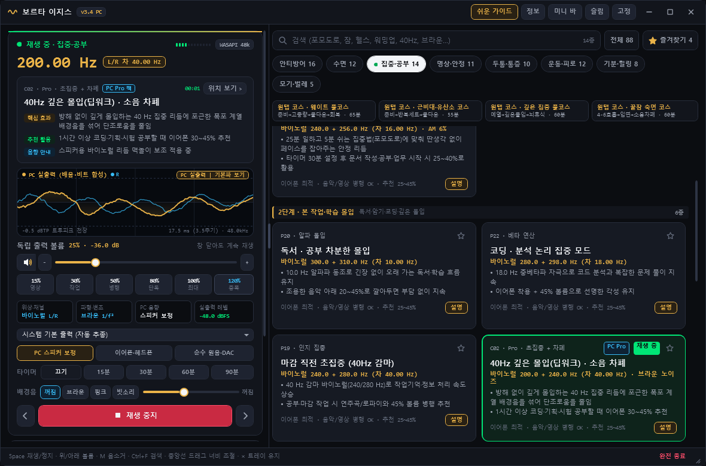
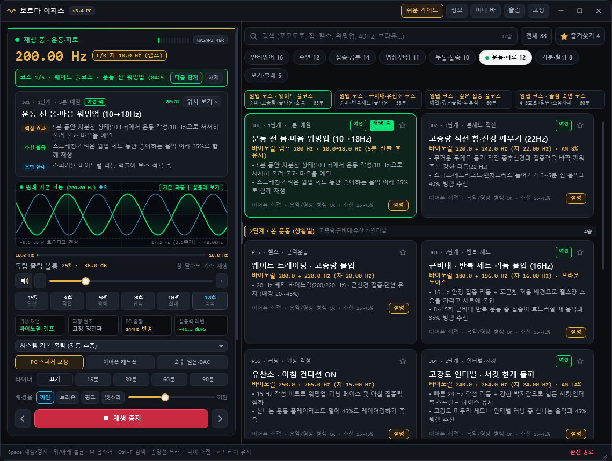

# Vorta Reso & Aegis Suite — 보르타 주파수 통합 운용·방어 시스템

전용 Android 기기(Galaxy S6·S7·A30) 및 메인 단말(Note 20 Ultra)·Windows PC 환경에서 저주파·고주파 공명, 우퍼 보호 DSP, 바이노럴·안티위상 시나리오를 운용하기 위한 보르타 프로젝트 전체 소스, 일괄 환경설정 스크립트, 연구 문서 모음입니다.

> **브랜드 의미**
> - **Vorta (보르타)**: Vortex(파동 에너지) + Volta(정밀 주파수 전위)의 합성어로, 흩어진 환경음과 작업 리듬을 정밀한 음향 파동으로 정렬하는 독자 브랜드입니다.
> - **Aegis (이지스)**: 수호 방패를 뜻하며, 동영상·작업·AI 툴과 충돌 없이 곁을 지키는 초경량 백그라운드 음향 방패입니다.



---

## 🧭 저장소 6대 디렉터리 안내

이 저장소는 **Diátaxis(디아탁시스) 국제 기술문서 표준**에 맞춰 누구나 직관적으로 관련 내용을 추론할 수 있도록 6개 핵심 폴더로 체계화되어 있습니다.

| 번호 / 폴더명 | 용도 및 핵심 내용 | 바로가기 |
|---|---|---|
| **`01-beginner-guide/`** | **입문자·전문가 통합 가이드**: 프로젝트 소개, PC v3.0→v3.2 해결 과정, **4기기 시너지 v1.1.1·통합 v5.2.1 완전 정복 및 사용 매뉴얼**, ELI10 사전(40종), 실측 화면 캡처 | [안내서 읽기](01-beginner-guide/README.md) |
| **`02-apps/`** | **PC + Android + 4기기 현역 소스코드**: **Windows PC v3.4.0**, **Android v3.4.6 (`Build 14`)**, **4기기 시너지 v2.0.0 (`CH1~CH4`)**, **통합 v5.2.1** | [앱 목록 보기](02-apps/README.md) |
| **`03-scenarios/`** | **현행 주파수 운용 시나리오**: 시간대·상황·전술별 주파수 시나리오 정본 (00~05) | [시나리오 보기](03-scenarios/README.md) |
| **`04-docs/`** | **설계서 및 공학 보고서**: UI/DSP 아키텍처 설계서, 상용화 라이선스 및 CROS/KIPRIS 정식인증 가이드, 기기별 분석 보고서 | [문서 허브](04-docs/README.md) |
| **`05-scripts/`** | **원클릭 배치 및 자동화 도구**: 원클릭 설치 배치파일(.bat), 디바이스 튜닝 쉘(.ps1/.sh), 빌드 및 파라미터 감사 파이썬(.py) | [스크립트 목록](05-scripts/README.md) |
| **`06-archive/`** | **연구 원문 및 과거 보고서 보관함**: 초기 연구 문서(.docx/.pdf), 구버전 시나리오 보고서, 참고 스크린샷 아카이브 | [아카이브 탐색](06-archive/README.md) |

---

## ⚡ 빠른 시작 (Windows PC v3.4.0 & Android v3.4.6)

Windows 10/11(`.NET Framework 4.8` 기본 내장) 환경에서 별도 무거운 외부 툴 없이 Python 3만 있으면 1초 만에 네이티브 x64 실행 파일을 빌드하고 바탕화면 바로가기를 만듭니다.

```powershell
git clone https://github.com/gyeomsVibe/261020-Vorta-Reso-Frequency-Tone-Generator.git
cd 261020-Vorta-Reso-Frequency-Tone-Generator
python 02-apps/pc-windows-vorta-aegis/install_pc.py
```

### v3.4.0 PC & Android v3.4.6 주요 기능
- **88종 여정 시나리오 & 4대 원탭 자동 코스**: 코어 48 + Pro 16 + 여정 24(`총 88종`), 전 8탭 `1단계→4단계` 순서 정렬, `웨이트/근비대/깊은집중/꿀잠` 자동 연계 코스
- **기본 간결 모드 vs 스튜디오 모드 차별화 & 12밴드 실시간 파동**: 기본 간결 모드(`정보+12밴드 실시간 VU 파동 → 5버튼 간결 볼륨 → 자동 코스 → 8탭`) vs 스튜디오 모드(`정보 → 자동 대형 파동 → 상세 볼륨+추천 → 음향 세부 → 아침추천/원탭/검색`) 공통 구조 통일
- **쉬운 한국어 & 1탭 `[설명]`/`[가이드]`**: 전문 약어(`포모도로` 등) 일상 한국어 정화 및 카드별 원리·활용법 즉시 팝업
- **오디오 DSP & 앰비언트 블렌더**: 바이노럴 진행 램프, 스테레오 핑크/브라운/빗소리 배경음(0~60%), `-0.50 dBTP` 무클리핑 리미터, 20초 수면 페이드아웃



---

## 📱 Android 4기기 시너지 (`v2.0.0`) & 통합앱 (`v5.2.1`) 일괄 배포

1. Android 스마트폰 **개발자 옵션 → USB 디버깅** 활성화 후 PC에 연결
2. `05-scripts/one-click-bat/` 내 원클릭 배치 스크립트 실행:
   - **신규 4기기 시너지 `v2.0.0` (`Build 200`) 병행 설치**: `05-scripts/one-click-bat/보르타_시너지_OS버전별_설치_원클릭.bat` (`CH 1` S7 · `CH 2` S6 · `CH 3` 트랜스 A30 · `CH 4` 본카운터 A30 · 전 대역 `0.5~200Hz` 무제한 자유주파수 · 기본 풀파워 + `85%` 배터리 보호)
   - **구버전 통합앱 `v5.2.1` 설치**: `05-scripts/one-click-bat/보르타_통합앱_OS버전별_설치_원클릭.bat` (A30 `볼륨 xx/15단` 표시 + S7/S6 저장 무점프 + 기존 글씨 크기 100% 보존)
   - 전용 기기 최적화: `05-scripts/one-click-bat/A30_S7_S6_보르타_레조_환경설정_원클릭.bat`
3. 상세 해결 과정 및 매일 사용법:
   - [05. 4기기 시너지 진단과 해결 과정 완전 정복 (`v1.1.1` & `v5.2.1`)](01-beginner-guide/05_4기기_시너지_진단과_해결과정_완전정복_v1.1.1_및_통합앱_v5.2.1.md)
   - [06. 실가동 4기기 보르타 시너지 및 통합앱 사용 매뉴얼](01-beginner-guide/06_실가동_4기기_보르타_시너지_및_통합앱_사용매뉴얼.md)

---

## ⚠️ 주의사항

- 본 소프트웨어 모음은 **의료기기가 아닙니다.** 질병의 진단·치료·예방 효과를 주장하지 않으며 집중·휴식·환경음 완화 보조 유틸리티로 설계되었습니다.
- 우퍼 및 앰프 장시간 구동 시 발열, 전원, 연결 상태를 주기적으로 확인하세요.

---

## 📜 라이선스 및 법적 고지

**All Rights Reserved (모든 권리 보유).** 오픈소스가 아니며, 비영리 개인 평가 열람 목적 외 저작권자의 명시적 서면 허가 없는 무단 복제, 상업적 재배포를 금합니다. 외부 GPL/LGPL 의존성은 **0건**입니다.
- 세부 라이선스 전문: [LICENSE](LICENSE) · [NOTICE](NOTICE) · [THIRD_PARTY_NOTICES.md](THIRD_PARTY_NOTICES.md) · [SECURITY.md](SECURITY.md)
- 정식 라이선스 인증 가이드: [04-docs/02-commercial-licensing/보르타_상용화_라이선스_및_정식인증_가이드.md](04-docs/02-commercial-licensing/보르타_상용화_라이선스_및_정식인증_가이드.md)

문의: yoongyeomkim@naver.com · GitHub [@gyeomsVibe](https://github.com/gyeomsVibe)
